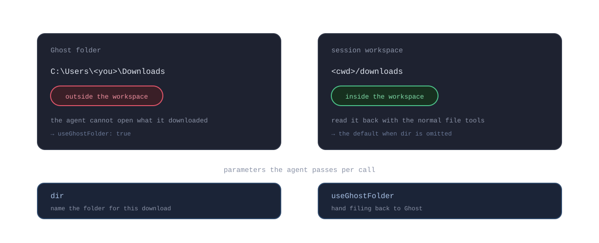
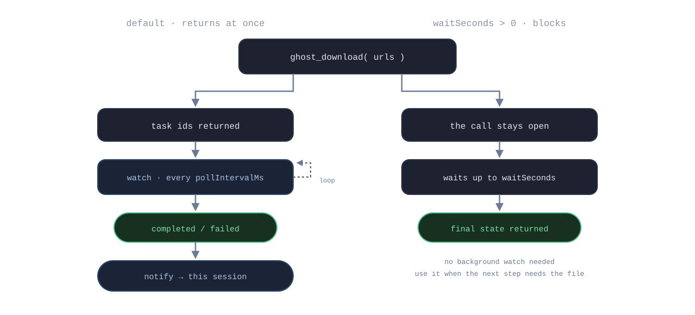

# Ghost Downloader: hand your downloads to a dedicated queue

This plugin routes downloads in DeepSeek Harness through Ghost Downloader's official command-line tool `ghd`, so the agent and your desktop share one download queue.

> **Terminology**: below, "arguments" are values the agent passes on each tool call, such as `dir`, `conflict`, `headers`, `waitSeconds`, `precheck`, `useGhostFolder` — `dir` is an argument, not a user toggle. "Settings" are values you configure on the plugin page that apply across calls, such as `ghdPath`, `allowedUrlSchemes`, `controlRemoveEnabled`, `waitLimitSeconds` (a ceiling).

## What problem it solves

Letting an agent fetch files with `curl`/`wget` looks easy but causes real trouble: no progress to inspect, resume and retry logic you must build yourself, tasks scattered across sessions with no central view, and files that often land somewhere the agent cannot read. Ghost Downloader is built for exactly this — one unified queue, resume support, inspectable state, and completion notification. With this plugin the agent just says "download this link"; Ghost does the rest, and the result is reported back to the current session when the download ends.

Prerequisite: install the `ghd` tool from Ghost Downloader's "Settings → Command line tools"; you can also set `ghdPath` in this plugin's settings to point at another executable.

## The eight tools at a glance

| Tool | What it does | Key parameters |
| --- | --- | --- |
| `ghost_download` | Submit links (HTTP/HTTPS, FTP, magnet/BT, eD2k, HLS/DASH) | `urls` (required), `dir`, `waitSeconds`, `select`, `name`, `conflict` (keep/overwrite, default keep), `headers`, `useGhostFolder`, `precheck` |
| `ghost_probe` | Preview a link's name, size and torrent file indexes without downloading | `url` (required), `headers`, `fresh` |
| `ghost_tasks` | List currently visible tasks with status and progress | `status` (filter), `limit` (cap) |
| `ghost_task` | Inspect one task in detail, with failure attribution | `taskId` (required) |
| `ghost_control` | Pause, resume, retry or remove tasks | `action` (pause/start/retry/remove), `taskIds`, `deleteFiles` (delete produced files on remove) |
| `ghost_wait` | Wait synchronously for tasks and report their final state, optionally verifying integrity | `taskIds` (required), `timeoutSeconds` (default 600 s), `checksum` (verify a digest; exactly one taskId) |
| `ghost_stats` | Aggregate counts and total bytes of visible tasks by status | `range` (7d/30d/all, default 7d) |
| `ghost_doctor` | Read-only health check of ghd, network, folders and config | none |

## Where files land (the important part)



Both `dir` and `useGhostFolder` are **arguments the agent passes on each call**, not toggles the user sets on the plugin page.

**When `dir` is omitted, downloads land in a `downloads` folder inside the current session working directory.** This is the single most important fact to know: Ghost's own download folder sits outside the workspace, where the agent's file tools cannot reach it. Landing in the session directory means the agent can open, parse and process the file in the very next step.

Same-named files are kept by default (keep); overwriting requires an explicit `conflict: "overwrite"`.

```
<session working directory>/
├── downloads/              <- default landing folder (ghd -o)
│   ├── report.pdf
│   └── archive.zip
└── ... (the agent can read these files directly)
```

When to use `useGhostFolder: true`: when you want Ghost to file downloads by its own category rules and do not mind the files landing outside the workspace (for example, purely for the user to pick up in the desktop app). **If both are passed, `useGhostFolder` wins and `dir` is ignored.** The trade-off is that the agent can no longer read them — pass `dir` when you need them back.

## Typical usage

Submit and return immediately; the task continues in the background and notifies you when done:

```json
{"urls": ["https://example.com/report.pdf"]}
```

Submit and wait up to 120 seconds (when the next step needs the file right away):

```json
{"urls": ["https://example.com/data.zip"], "waitSeconds": 120}
```

Precheck free space and same-named files before submitting (a report only, never an automatic skip):

```json
{"urls": ["https://example.com/big.iso"], "precheck": true}
```

A precheck is advice, never an automatic skip. It depends on `ghd probe` reporting a
file size — **when Ghost reports none, the space and same-name checks are labelled
"not checked" rather than treated as passing**. With `useGhostFolder` the
destination belongs to Ghost, so there is no target folder to precheck.

Retry every failed task (`retry` with no `taskIds` means all failed tasks):

```json
{"action": "retry"}
```

Verify integrity once the download completes (`checksum` requires **exactly one `taskId`**; passing several is a hard error):

```json
{"taskIds": ["tsk_0123"], "timeoutSeconds": 300, "checksum": "sha256:9f86d081884c7d659a2feaa0c55ad015a3bf4f1b2b0b822cd15d6c15b0f00a08"}
```

`checksum` also accepts a bare hex digest, with the algorithm inferred from its length (32=md5, 40=sha1, 64=sha256, 128=sha512). `ghd` has no checksum support of its own, so the plugin streams the digest itself after the file has landed — a large download is never held in memory. Three outcomes:

- match → the result carries a "verified" line (rendered in Chinese, `校验通过：<algorithm> <digest>`), and `checksum.verified` is `true`;
- mismatch → `ok:false` with `error.code = "checksumMismatch"` and both the expected and the actual value;
- the landed file cannot be located → `error.code = "checksumNotVerified"`.

## Background watching and notification



By default a submission returns immediately with the task ids, and the plugin keeps watching those tasks in the background; when one finishes or fails, it proactively reports the result back to the session that started it — no polling needed. Watching is not infinite: if a single task is still running after `watchLimitMinutes` (a setting, default 30 minutes), the plugin stops watching and notifies the session; use `ghost_task` to check manually then. When you need the file on the spot, use `waitSeconds` or `ghost_wait` for a synchronous wait (`ghost_wait` defaults to at most 600 seconds).

## Safety and boundaries

- The plugin blocks shell downloads that bypass Ghost (`curl -o`, `curl -O`, `wget`) and redirects them to `ghost_download`.
- `allowedUrlSchemes` is a protocol allow-list, defaulting to http, https, ftp, magnet, ed2k; links outside the list are rejected outright.
- `ghost_control`'s `remove` deletes the task; with `deleteFiles: true` it also deletes the files that task already produced — a destructive operation. The `controlRemoveEnabled` setting can disable remove from the plugin page.
- `headers` end up in `ghd`'s command-line arguments and are visible in the local process list; do not put sensitive credentials there.

## How this differs from similar tools

First, how much this comparison can be trusted:

- **Verified by reading the vendor's own documentation**: Mister Download Manager's (MDM) tool list, protocol support, checksum algorithms, and the default state of its automation API.
- **Second-hand, not re-checked line by line**: the current state of MCP wrappers for aria2 / qBittorrent / Transmission / yt-dlp, MCP's blocking behaviour for long tasks and the newer Tasks extension, and the issue where a missing precheck filled a system drive.
- "Nothing else found in this sample" means only that — **it does not mean nobody else does it**.

The closest counterpart is **MDM**: it ships an MCP server with 7 tools (`list` / `add` / `pause` / `resume` / `remove` / `start_queue` / `stop_queue`), supports http/https/ftp/ftps, offers 5 checksum algorithms (MD5 / SHA-1 / SHA-256 / SHA-512 / CRC32), and its **automation API is off by default and must be enabled manually** (all verified against the vendor documentation).

Where this plugin differs:

1. **A closed loop of 8 tools.** Against MDM's 7 we add `probe` (inspect name and size without creating a task), `wait` (block until finished), `stats` (summarise the queue by status) and `doctor` (read-only health check). MDM's `start_queue` / `stop_queue` have no counterpart here — we do not expose a whole-queue switch.
2. **Broader protocol coverage**: besides http/https/ftp we accept `magnet`, `ed2k`, `.torrent` URLs, HLS and DASH manifests; MDM covers http/https/ftp/ftps.
3. **The default landing folder is tied to the session working directory.** With no `dir`, files land in `<session working directory>/downloads` precisely so the agent can read them back afterwards — **nothing else in this sample was found doing that**.
4. **Precheck reports, it never skips.** `precheck` returns blocked / skip / warn as advice and leaves the decision to the agent. The survey mentions a project that filled a system drive for lack of a precheck; we choose to report rather than decide, which still does not guarantee there is enough space.
5. **Both synchronous and asynchronous modes.** By default the call returns task ids at once and the plugin watches in the background, notifying on completion; when the file is needed immediately, `waitSeconds` or `ghost_wait` blocks instead. The survey (second-hand) says MCP tools block by default and that long tasks rely on the newer Tasks extension for polling and cancellation — if that holds, our dual mode asks less of the caller.
6. **Checksums are now covered, roughly at parity with MDM**: `checksum` supports md5 / sha1 / sha256 / sha512 — **4 algorithms** against MDM's 5 (it also has CRC32). **We are one short here, stated plainly.**

And where this plugin is honestly looser than MDM:

- **MDM's magnet handling pops an "Add torrent" dialog that forces a human to choose files**; this plugin's agent can submit a magnet fully automatically and pick files itself via `select`. **That is more automation and a looser safety boundary.** When human sign-off is required, tighten `controlRemoveEnabled` and `allowedUrlSchemes`, or require confirmation in the workflow layer.

## Diagnostics

When downloads fail or tasks keep erroring, run `ghost_doctor` first: it checks `ghd --version`, `ghd tasks`, a network/certificate probe against a known small file, writability of the download folder, and Ghost's own `UserConfig.json` download folder and proxy settings. It never touches the download queue, but it is not side-effect free: it writes and immediately deletes a temporary probe file and makes one network request. `ghost_task` gives a hedged "possible cause" attribution for failures (certificate, DNS, auth, gone, range request, etc.).

`ghost_stats` only aggregates **currently visible** tasks: Ghost keeps no download history, so its `range` parameter (7d/30d/all) is a placeholder for API consistency and cannot actually filter by time — no ledger is invented.
