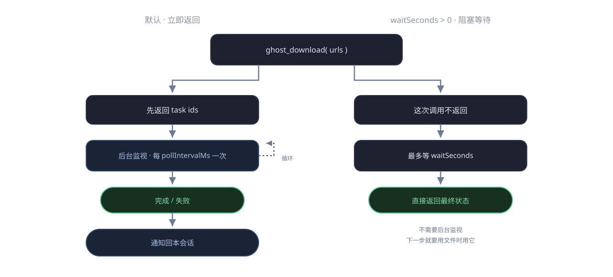

# Ghost Downloader 下载：把下载交给专业队列

这个插件把 DeepSeek Harness 里的下载任务，交给本机 Ghost Downloader 的官方命令行工具 `ghd` 执行，让智能体和桌面端共用同一个下载队列。

> **术语说明**：下文「参数」指智能体每次调用工具时传的值，例如 `dir`、`conflict`、`headers`、`waitSeconds`、`precheck`、`useGhostFolder`——`dir` 是参数，不是用户开关。「设置」指你在插件页配置、跨调用生效的值，例如 `ghdPath`、`allowedUrlSchemes`、`controlRemoveEnabled`、`waitLimitSeconds`（上限）。

## 它解决什么问题

让智能体自己用 `curl`/`wget` 拉文件，看似直接，实则麻烦多多：进度看不到、断点续传和失败重试要自己实现、任务散落在各个会话里无从管理、下载完的文件还常常落在智能体读不到的地方。Ghost Downloader 是专门干这件事的工具——统一队列、断点续传、状态可查、完成后可通知。本插件让智能体只需说一句「下载这个链接」，剩下的交给 Ghost，并在下载结束时把结果送回当前会话。

前提：先在 Ghost Downloader 的「设置 → 命令行工具」安装 `ghd`；也可在本插件的设置里用 `ghdPath` 指定可执行文件路径。

## 八个工具一览

| 工具 | 干什么 | 关键参数 |
| --- | --- | --- |
| `ghost_download` | 提交下载链接（HTTP/HTTPS、FTP、磁力/BT、eD2k、HLS/DASH） | `urls`（必填）、`dir`、`waitSeconds`、`select`、`name`、`conflict`（keep/overwrite，默认 keep）、`headers`、`useGhostFolder`、`precheck` |
| `ghost_probe` | 预览链接的文件名、大小与种子文件索引，不真正下载 | `url`（必填）、`headers`、`fresh` |
| `ghost_tasks` | 列出当前可见任务及状态、进度 | `status`（按状态过滤）、`limit`（限量） |
| `ghost_task` | 查看单个任务的详情，并给出失败归因 | `taskId`（必填） |
| `ghost_control` | 暂停、继续、重试或移除任务 | `action`（pause/start/retry/remove）、`taskIds`、`deleteFiles`（remove 时删除已产生的文件） |
| `ghost_wait` | 同步等待任务结束并回报最终状态 | `taskIds`（必填）、`timeoutSeconds`（默认 600 秒） |
| `ghost_stats` | 按状态汇总当前可见任务的数量与总字节数 | `range`（7d/30d/all，默认 7d） |
| `ghost_doctor` | 只读体检 ghd、网络、目录与配置 | 无参数 |

## 文件落在哪里（最重要）


`dir` 与 `useGhostFolder` 都是**智能体每次调用时传的参数**，不是用户在插件页配的开关。

**不传 `dir` 时，下载默认落到当前会话工作目录的 `downloads` 文件夹。** 这是最影响使用的一点：Ghost 自己的下载目录在工作区之外，智能体的文件工具读不到；落到会话目录里，智能体才能在下一步直接打开、解析、处理刚下载的文件。

同名文件默认保留（keep），需要覆写时要显式传 `conflict: "overwrite"`。

```
<会话工作目录>/
├── downloads/              ← 默认落点（ghd -o）
│   ├── report.pdf
│   └── archive.zip
└── ...（智能体可直接读取这些文件）
```

什么时候用 `useGhostFolder: true`：当你希望按 Ghost 自己的分类规则归档、不介意文件落在工作区之外（例如纯粹让用户自己在桌面端取用）时，用它跳过 `dir`。代价是智能体此后读不到文件；需要读回时请传 `dir`。

## 典型用法

提交并立即返回，任务在后台继续，完成后自动通知：

```json
{"urls": ["https://example.com/report.pdf"]}
```

提交并同步等待最多 120 秒（适合下一步立刻要用文件）：

```json
{"urls": ["https://example.com/data.zip"], "waitSeconds": 120}
```

提交前预检目标目录空间与同名文件（只报告，不会自动跳过）：

```json
{"urls": ["https://example.com/big.iso"], "precheck": true}
```

失败后重试全部 failed 任务（`retry` 不传 `taskIds` 时表示所有失败任务）：

```json
{"action": "retry"}
```

## 后台与通知



默认提交后立即返回任务 id，插件会在后台持续监视这些任务；当任务结束或失败时，主动把结果送回发起下载的会话，无需智能体反复轮询。监视不是无限期的：单个任务超过 `watchLimitMinutes`（设置，默认 30 分钟）仍未结束，插件会停止监视并通知会话，此时可用 `ghost_task` 手动查看。需要当场拿到文件时，用 `waitSeconds` 或 `ghost_wait` 同步等待（`ghost_wait` 默认最多 600 秒）。

## 安全与边界

- 插件会拦截 `curl -o` / `curl -O` / `wget` 这类绕过 Ghost 的 shell 下载，并引导改用 `ghost_download`。
- `allowedUrlSchemes` 是协议白名单，默认允许 http、https、ftp、magnet、ed2k；不在名单里的链接直接拒绝。
- `ghost_control` 的 `remove` 会删除任务；加上 `deleteFiles: true` 还会删除该任务已产生的文件，属于破坏性操作。可用 `controlRemoveEnabled` 设置在插件页关闭 remove。
- `headers` 会进入 `ghd` 的命令行参数，本机进程列表可见；不要把敏感凭据写在这里。

## 诊断

下载不通、任务总是失败时，先跑 `ghost_doctor`：它只读检查 `ghd --version`、`ghd tasks`、一个已知小文件的网络/证书探测、下载目录是否可写，以及 Ghost 自己的 `UserConfig.json` 里的下载目录与代理设置。`ghost_task` 会对失败原因给出「可能原因」式的归因（证书、DNS、鉴权、资源不存在、范围请求等）。

`ghost_stats` 只统计**当前可见**的任务：Ghost 不保留下载历史，它的 `range` 参数（7d/30d/all）只是接口一致的占位，并不能真的按时间过滤，也不会伪造一份账本。
